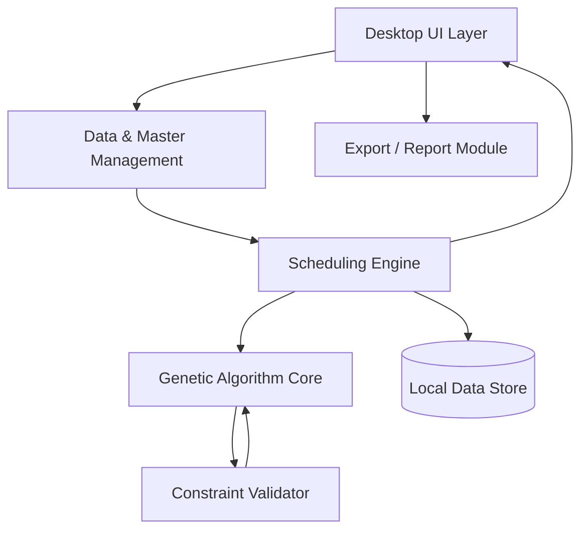

# Academic Timetable Generator
### Project Description

---

## 1. Introduction

The **Academic Timetable Generator** is a desktop application that automatically builds a conflict-free weekly class schedule for an academic department, using a **Genetic Algorithm (GA)** as its core optimization engine.

Given structured input data — courses and their credit structure, faculty, rooms/labs, and the batch/sub-batch structure of a semester — the system produces a complete timetable covering lectures, tutorials, and lab sessions, while guaranteeing that hard scheduling rules are never broken and progressively improving the schedule against softer, "quality of life" preferences (fewer gaps, balanced daily load, etc.).

A real institutional timetable (BTech V Semester, July–Dec 2026) was used as a reference to understand the true complexity of the problem this project needs to solve.

## 2. Background & Problem Statement

Manually built timetables — like the reference one supplied for this project — reveal how complex real academic scheduling actually is:

- A semester's students are split into many **sub-batches** (in the reference: B1, B2, B3 … B11, B21, B22, B31 — 14 sub-batches).
- For some courses, several sub-batches are **merged into a larger group** for a shared lecture (e.g., B1+B2+B3 form group "BX" for one course), while for other courses a *different* merge is used (e.g., B1 through B5 form "BATCH1" for another course). These groupings are **not a single fixed hierarchy** — they overlap and change from course to course.
- The same course can require **different session types** for the same students in the same week: a large combined **Lecture (L)**, a smaller batch-wise **Tutorial (T)**, and/or a **Practical/Lab (P)**.
- Some sub-batches follow a **specialization elective** (e.g., a Data Analysis & Visualization lab for one sub-batch, a Deep Learning lab for two others) that doesn't apply to the rest of the semester.
- **Faculty** teach multiple groups of the same course and must never be double-booked; some courses even split faculty by group.
- **Rooms** are typed (lecture theatres, classrooms, computer labs) and must match both the session type and the size of the attending group.
- **Lab sessions occupy two contiguous one-hour slots**, not one.
- Any slot left free for a sub-batch is expected to default to **"minor project" time** rather than sit unlabeled.

Building this by hand is slow, error-prone (double-bookings are easy to miss when groupings overlap this way), and has to be redone almost from scratch whenever a batch count, faculty list, or elective mix changes — which happens every semester and differs again from one admission batch to the next (e.g., a 2024–28 batch may have roughly 6 courses, 3 labs, 4 batches and 12–13 sub-batches, a different scale than the reference semester).

**Problem statement:** There is no tool that lets a department describe its courses, faculty, rooms, and batch/grouping structure once, and then automatically generate a valid, reasonably optimized timetable — with the ability to regenerate quickly whenever inputs change.

## 3. Objectives

- Let an administrator/coordinator define courses, credits, faculty, rooms, and the batch/sub-batch/grouping structure through the application (no hand-drawn grids).
- Automatically derive the required weekly lecture and tutorial hours from each course's credits, and apply a fixed 2-hour weekly slot for every lab, per batch/sub-batch.
- Use a **Genetic Algorithm** to search for a timetable that satisfies all hard constraints (no clashes) and scores well against soft preferences (balanced, compact schedules).
- Present the generated timetable in views similar to the institutional format (day × time-slot grid; per-batch, per-faculty, and per-room views).
- Allow manual fine-tuning after generation, and re-generation when inputs change.
- Export the final timetable to shareable/printable formats.

## 4. Scope

**In scope**
- Single-department, single-semester timetable generation (extensible to multiple semesters/programs run one at a time or in batch).
- Lecture, Tutorial, and Practical (lab) session types.
- Arbitrary, per-course batch groupings (not restricted to one fixed hierarchy).
- Credit-based lecture/tutorial hour computation; fixed-duration labs.
- Genetic-algorithm-based schedule generation with configurable hard/soft constraints.
- Manual post-generation editing with live conflict re-validation.
- Export to PDF/Excel/print-ready layouts.

**Out of scope (for the initial version)**
- Cross-department, campus-wide room/faculty sharing (can be a future extension).
- Student-level individual elective choice optimization (elective *groups* are supported; seat-level elective allocation is not).
- Mobile app / web-hosted multi-user real-time collaboration (desktop, primarily single coordinator use).
- Automatic examination timetabling (only class timetables are in scope).

## 5. Target Users

| User | Needs from the system |
|---|---|
| Timetable Coordinator / Admin | Enter master data, configure constraints, run generation, review and finalize |
| Head of Department | Review faculty load and final timetable, approve |
| Faculty | View their own personal schedule and load |
| Students / Batch Representatives | View their sub-batch's schedule |

## 6. Key Terminology

| Term | Meaning |
|---|---|
| Batch | A top-level admitted class for a program/year (e.g., "2024–28 CSE") |
| Sub-batch | A smaller division of a batch (e.g., B1, B2 …) used for tutorials/labs |
| Batch Group | A course-specific, ad-hoc union of sub-batches attending a session together (e.g., B1+B2+B3) |
| L / T / P | Lecture / Tutorial / Practical (lab) — the three session types |
| Credit | Academic weight of a course, used to derive weekly L and T hours |
| Slot | A fixed time period in the weekly grid (e.g., 9:00–9:55) |
| Hard Constraint | A rule that must never be violated in a valid timetable |
| Soft Constraint | A preference the GA tries to satisfy but may trade off |
| Chromosome | One complete candidate timetable, in GA terms |
| Fitness | A numeric score describing how good/valid a candidate timetable is |

## 7. High-Level Architecture

- **Data & Master Management** — courses, faculty, rooms, batches/sub-batches, batch groups, constraints.
- **Scheduling Engine** — turns master data into the problem definition the GA operates on.
- **Genetic Algorithm Core** — generates and evolves candidate timetables.
- **Constraint Validator** — scores every candidate against hard and soft rules.
- **Local Data Store** — persists projects/configurations between sessions.
- **Export / Report Module** — produces printable/shareable output.

## 8. Why a Genetic Algorithm

Timetabling is a classic **NP-hard combinatorial optimization problem**: the number of possible session/slot/room/faculty combinations grows extremely fast, and there is rarely a single "correct" schedule — only better and worse ones once faculty preferences, gaps, and balance are considered. A Genetic Algorithm fits this well because it:

- Naturally handles a **mix of hard and soft rules** through a fitness function, rather than requiring an exact solver for every rule.
- Can produce a **good solution in reasonable time** even when an exact/perfect solution is impractical to search for exhaustively.
- Can be **re-run** to produce alternative valid timetables when the first result isn't preferred.
- Scales reasonably as sub-batches, courses, or constraints are added, by tuning population size and generations rather than redesigning the algorithm.

## 9. Solution Approach (Summary)

- Each **candidate timetable** is treated as a chromosome — a full assignment of every required session to a (day, time-slot, room, faculty) combination.
- A **fitness function** heavily penalizes hard-constraint violations (clashes, capacity mismatches, broken lab blocks) and adds smaller penalties/bonuses for soft-constraint quality (gaps, spread, balance).
- The GA evolves a population of candidate timetables across generations using **selection, crossover, and mutation**, keeping the best candidates (elitism), until a valid, high-scoring timetable is found or a stopping condition is reached.

Full technical detail is defined in the companion **Project Requirement.md** document.

## 10. Deliverables

1. Working desktop application (data entry, GA-based generation, viewing, editing, export).
2. Genetic Algorithm scheduling engine, decoupled from the UI.
3. Sample generated timetable(s) validated against a real dataset.
4. Exported timetable in PDF/Excel/print format.
5. Documentation: this description, the requirements specification, and user/setup notes.

## 11. Expected Benefits

- Timetable creation time reduced from days of manual work to minutes.
- Elimination of faculty/room/batch double-booking errors.
- Easy regeneration when a course, faculty member, or room changes.
- Ability to compare multiple valid timetable options and choose the best.
- Reusable across semesters and across batches of different sizes.

## 12. Assumptions

- One department/program is scheduled at a time (though the data model allows more than one to be defined).
- Working days, slot timings, and slot duration are configurable but assumed fixed for a given run.
- The exact "credits → weekly lecture/tutorial hours" formula is configurable (see Requirement document, Section 9 and 12), since this varies by institution.

## 13. Future Enhancements

- Multi-department / campus-wide shared-resource scheduling.
- Web/cloud version with real-time multi-user editing.
- AI-assisted conflict-resolution suggestions during manual editing.
- Automatic examination/seating timetable module built on the same engine.
